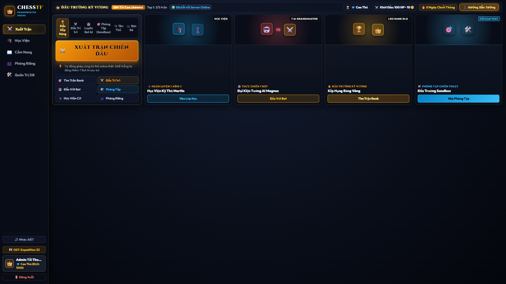
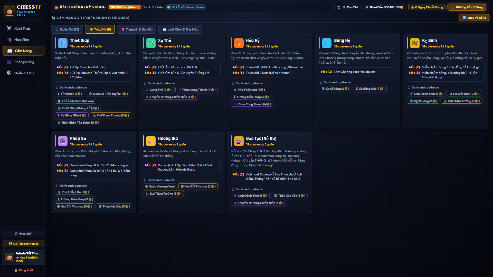
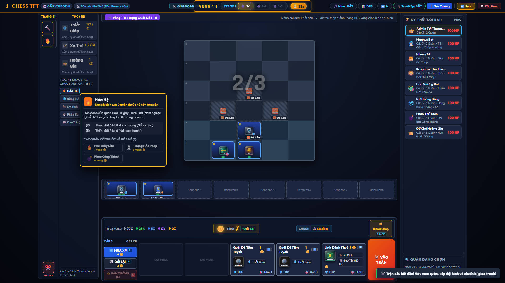
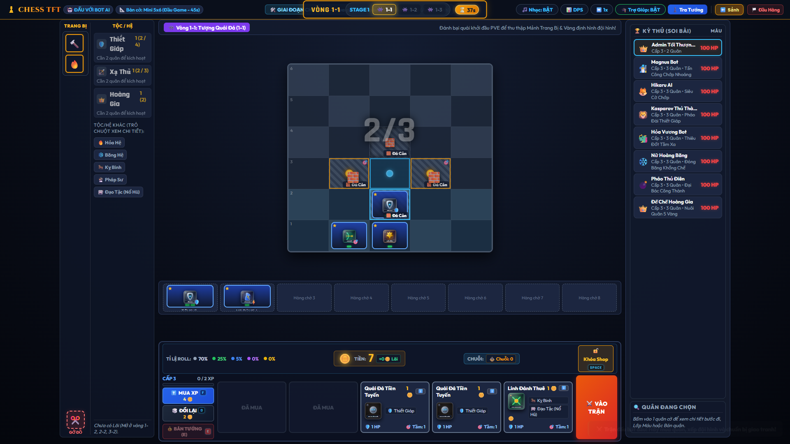
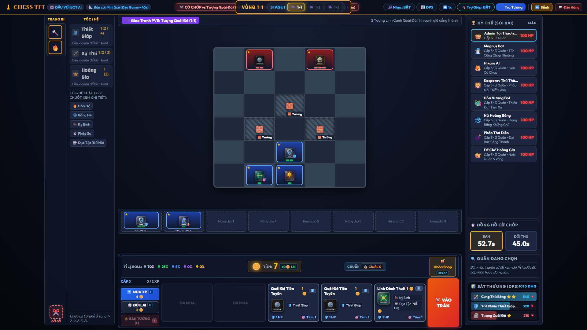
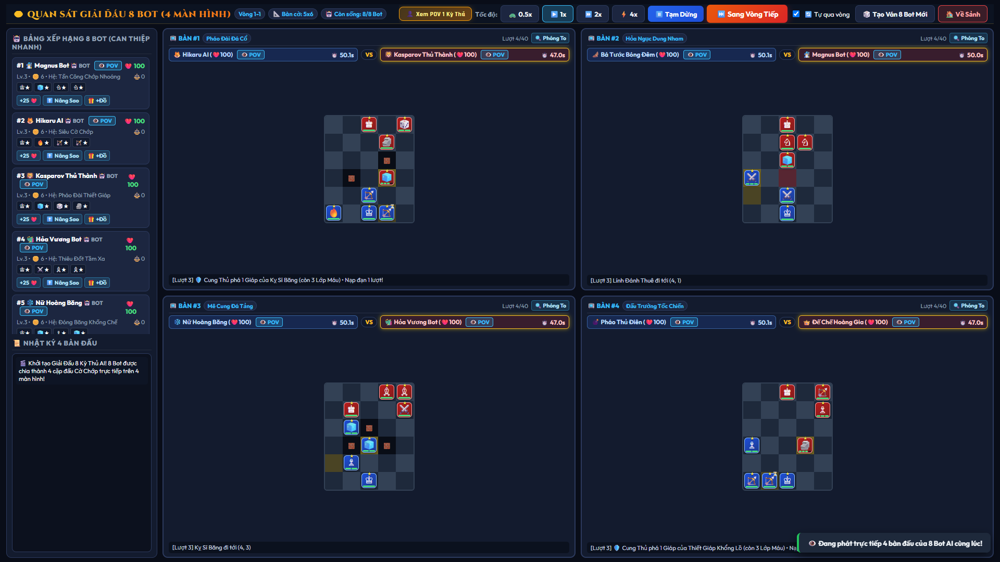
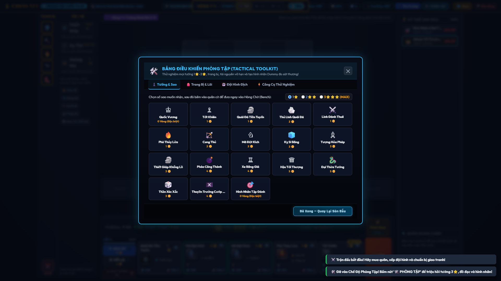
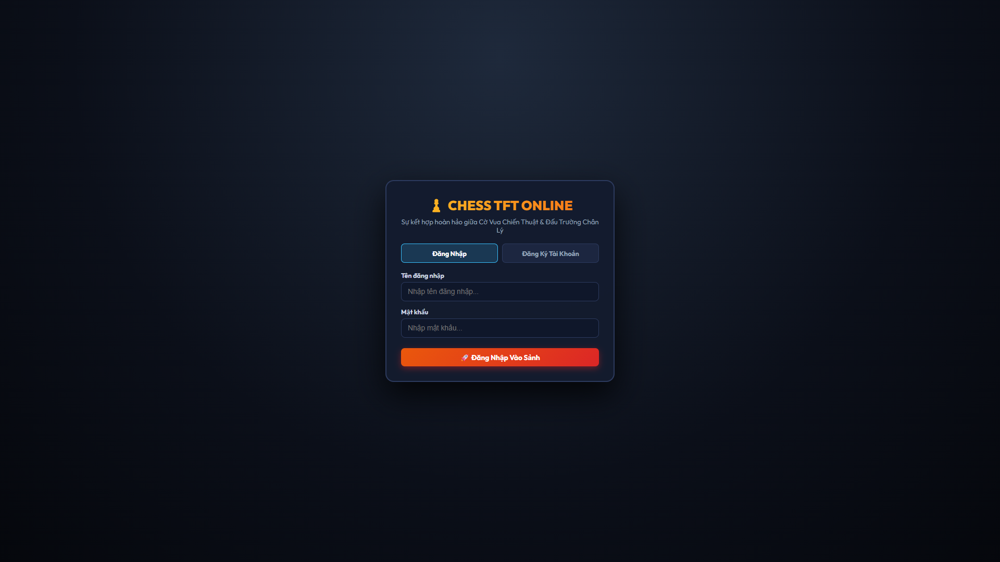

# ♟️ Chess TFT Online — Tactical Blitz Arena & Grandmaster Auto-Battler

<p align="center">
  
  
  
  
  
  
</p>

> **Sự kết hợp đột phá giữa Cờ Vua Cổ Điển & Đấu Trường Chân Lý (TFT)**  
> *Tư duy cờ vua chuẩn xác • Mua sắm & Nâng cấp 3⭐ • Kích hoạt 8 Tộc/Hệ • Đồng hồ Cờ Chớp Blitz (1x/2x) • Lội ngược dòng & Nổ hũ Đạo Tặc • Phòng tập Chiến Thuật Sandbox • Chế độ Khán giả 4 Màn hình*

---

## 🌟 Giới Thiệu Dự Án

**Chess TFT Online** là tựa game web chiến thuật thời gian thực (Real-time Tactical Auto-Battler & Blitz Chess) mang phong cách **AAA Gaming Client** (tương tự Riot Client, Hearthstone) với giao diện **Obsidian Dark Gold** sang trọng. Trò chơi kết hợp trọn vẹn giữa:
- **Tư duy Cờ Vua cổ điển**: Quy tắc di chuyển, bắt quân, chiếu tướng, phong cấp và đồng hồ cờ chớp Blitz căng thẳng từng giây.
- **Kinh tế & Chiến thuật Đấu Trường Chân Lý (TFT)**: Cửa hàng tướng ngẫu nhiên, nâng cấp sao $1\bigstar \rightarrow 2\bigstar \rightarrow 3\bigstar$, 8 Tộc/Hệ bổ trợ, ghép Trang bị hoàn chỉnh, chọn Lõi Công Nghệ (Augments), tích lũy chuỗi thắng/thua và nổ hũ Đạo Tặc.
- **Tối ưu hiển thị đa nền tảng**: Tương thích hoàn hảo cả màn hình Laptop **1366x768** và Desktop **1920x1080** không cần thu phóng chuột.

---

## 📸 Bộ Sưu Tập Giao Diện Thực Tế (Playwright Showcase)

Toàn bộ ảnh chụp màn hình dưới đây được tự động ghi lại trực tiếp từ phiên bản game mới nhất thông qua kịch bản kiểm thử **Playwright Core** độ phân giải 1080p:

### 1. Sảnh Chờ Gaming Hub & Cẩm Nang Bách Khoa Toàn Thư (Codex)
| Sảnh Chờ Chính (Royal Grandmaster Hub) | Cẩm Nang 8 Tộc / Hệ & 15 Quân Cờ (Codex) |
|:---:|:---:|
|  |  |

---

### 2. Sàn Đấu Giai Đoạn Chuẩn Bị & Soi Nước Đi Chuẩn Esports
| Sàn Đấu Giai Đoạn Chuẩn Bị (Prep Phase & Shop TFT) | Rê Chuột Xem Nước Đi & Tầm Đánh Chiến Thuật |
|:---:|:---:|
|  |  |

---

### 3. Giao Tranh Nảy Lửa (DPS Meter) & Chế Độ Khán Giả Caster 4 Bàn
| Giao Tranh Thực Tế & Biểu Đồ Sát Thương (Combat DPS) | Chế Độ Khán Giả / Trọng Tài GM (4 Màn Hình 2x2) |
|:---:|:---:|
|  |  |

---

### 4. Phòng Tập Thử Nghiệm Sức Mạnh & Màn Hình Xác Thực
| Bảng Điều Khiển Phòng Tập Chiến Thuật (Tactical Toolkit) | Màn Hình Đăng Nhập / Đăng Ký (Dark Obsidian Theme) |
|:---:|:---:|
|  |  |

---

## ⚡ Các Tính Năng & Cơ Chế Gameplay Đột Phá

### 1. ⚔️ Bàn Cờ Mở Rộng Theo Stage & Luật Hòa Hơn Cờ
- **Quy mô bàn cờ tự động mở rộng theo thời gian**:
  - **Stage 1 (Đầu game)**: Bàn cờ Mini `5x6` — Đồng hồ Blitz `45s + 3s/nước`.
  - **Stage 2 (Giữa game)**: Bàn cờ Mở rộng `6x7` — Đồng hồ Blitz `60s + 3s/nước`.
  - **Stage 3+ (Cuối game)**: Bàn cờ Chuẩn `8x8` — Đồng hồ Blitz `75s + 4s/nước`.
- **Cơ chế Hết Cờ Đặt Trên Sân (Trừ Vua)**:
  - Một bên bị tiêu diệt sạch toàn bộ quân cờ trợ chiến (chỉ còn lại duy nhất Vua) sẽ **THUA NGAY LẬP TỨC**.
  - **Luật Hòa Hơn Cờ**: Khi hết lượt tối đa hoặc hết giờ, bên nào còn nhiều quân hơn sẽ thắng; sát thương trừ máu = `(3 + Stage) + Chênh lệch quân số`.
- **Cảnh báo Chiếu Tướng (King in Check Alert)**: Băng rôn cảnh báo rực rỡ và ô Vua nhấp nháy đỏ khi bị đối phương đe dọa.

---

### 2. 🛒 Cửa Hàng TFT & Dải Phím Tắt Nhanh Chuẩn Pro
- **5 thẻ bài ngẫu nhiên** mỗi vòng với tỷ lệ xuất hiện theo cấp độ linh hồn.
- **Tự động hợp nhất sao**: Mua 3 quân cờ cùng bậc để tự động ghép thành $2\bigstar$ và $3\bigstar$, gia tăng lớp máu (HP Layers) và tầm đánh.
- **Bộ phím tắt nhanh một chạm**:
  | Phím | Chức Năng | Chi Tiết |
  |:---:|:---|:---|
  | **`D`** | **Reroll Shop** | Đổi lại 5 thẻ bài mới (tốn 2 Vàng hoặc dùng Lượt Miễn Phí). |
  | **`F`** | **Mua XP** | Mua 4 điểm kinh nghiệm nâng cấp sàn đấu (tốn 4 Vàng). |
  | **`E`** | **Bán Tướng** | Bán nhanh tướng đang trỏ chuột hoặc đang chọn, hoàn trả vàng chuẩn sao. |
  | **`W`** | **Triệu Hồi / Thu Hồi** | Đưa nhanh tướng từ Hàng Chờ lên sàn đấu hoặc thu hồi về Hàng Chờ. |
  | **`SPACE` / `X`** | **Khóa Cửa Hàng (Lock Shop 🔒)** | Khóa cố định 5 thẻ bài cho vòng đấu kế tiếp. |

---

### 3. 🛡️ Hệ Thống 15 Quân Cờ & 8 Tộc / Hệ Tương Khắc
- **Thiết Giáp**: Tăng thêm lớp Giáp Máu bảo hộ cho toàn đội hình; mốc cao bảo hộ cả Quốc Vương.
- **Xạ Thủ**: Gia tăng tầm bắn xa, cho phép tấn công xuyên tường đá cản.
- **Hoàng Gia**: Gia tăng sát thương trừ máu linh hồn đối thủ và bảo vệ Quốc Vương.
- **Hỏa Hệ**: Đòn đánh thiêu đốt gây nổ lan 8 ô xung quanh mục tiêu.
- **Băng Hệ**: Khống chế làm choáng (đóng băng 1 lượt) khi tiếp cận kẻ địch.
- **Pháp Sư**: Phá hủy nhiều lớp máu bảo hộ cùng lúc và gia tăng tầm phép.
- **Kỵ Binh**: Miễn nhiễm sông, tăng tốc đồng hồ và hồi máu khi hạ gục kẻ địch.
- **Đạo Tặc (Nổ Hũ - Fortune)**: Tích lũy điểm thưởng qua các chuỗi thua; chỉ cần **1 trận Thắng** là NỔ HŨ nhận cơn mưa Vàng, Trang Bị và Tướng 5 Vàng!

---

### 4. 🎰 Cơ Chế Lội Ngược Dòng (Comeback Engine)
- **🎲 Lượt Đổi Shop Miễn Phí (Free Rerolls)**: Chuỗi thua $\ge 3$ trận nhận ngay **+1 Lượt Đổi Shop Miễn Phí** mỗi vòng.
- **📦 Hòm Cứu Trợ Lội Ngược Dòng**: Chuỗi thua $\ge 4$ trận tặng ngay **+10 Vàng** và **1 Trang Bị Hoàn Chỉnh** ngẫu nhiên.
- **🛡️ Ý Chí Phục Thù (Last Stand)**: Khi Máu tụt xuống $\le 25$ HP, lập tức kích hoạt:
  - **+15 Vàng**.
  - **Quốc Vương** nhận thêm **+1 Lớp Máu vĩnh viễn**.
  - Cộng thêm **+15 giây** vào Đồng Hồ Cờ Chớp.

---

### 5. 🎯 Rê Chuột Xem Trước Nước Đi & Biểu Đồ Sát Thương (DPS Meter)
- **Instant Tactical Range Preview**:
  - Khi rê chuột vào bất kỳ quân cờ nào trên sàn (cả quân ta và quân địch), bàn cờ lập tức kích hoạt vòng tròn xanh ngọc `.cell-preview-move` (nước đi hợp lệ) và tâm ngắm hổ phách `.cell-preview-attack` (tầm tấn công).
  - Quân ở Hàng Chờ & Shop hiển thị **Floating Mini-Grid 5x5 Tooltip** mô phỏng quỹ đạo di chuyển thực tế.
- **Biểu Đồ Sát Thương Toàn Năng (Global Combat DPS Meter)**: Nút `📊 DPS` hoạt động trong toàn bộ mọi trận đấu (Rank, Solo, Custom, Sandbox), theo dõi chi tiết sát thương và số đòn đánh theo thời gian thực.
- **Tùy Chỉnh Tốc Độ Solo AI (1x / 2x)**: Nút `⏩ 1x / 2x` tăng tốc độ suy nghĩ của Bot và nhịp độ đồng hồ cờ chớp cho kỳ thủ muốn luyện tập thần tốc.
- **Cụm Nút Điều Khiển An Toàn**: Tách biệt rõ ràng nút `⬅️ Sảnh` và nút `🏳️ Đầu Hàng` (viền đỏ nổi bật + hộp thoại xác nhận 2 bước chống bấm nhầm).
- **Minh Bạch Giá Bán Tướng**: Hiển thị rõ công thức hoàn tiền `💰 Bán (+5🪙) (-1🪙 phí ghép)` khi bán tướng 2⭐ và 3⭐.

---

### 6. 🛠️ Phòng Tập Chiến Thuật (Tactical Sandbox)
- Tùy ý triệu hồi bất kỳ quân cờ nào với cấp độ $1\bigstar, 2\bigstar, 3\bigstar$ thẳng vào sàn đấu.
- Bơm không giới hạn Vàng (+999🪙), Max Cấp 8, Lõi Công Nghệ và Trang Bị.
- Đặt **Hình Nhân Tập Đánh (Target Dummy)** 50 HP làm bia đỡ đạn.
- Bật/Tắt AI đánh trả để thoải mái thử nghiệm kỹ năng, sát thương và thời gian chuẩn bị vô hạn (`♾️ VÔ HẠN`).

---

### 7. 👁️ Chế Độ Khán Giả / Trọng Tài GM (4 Màn Hình Trực Tiếp)
- Theo dõi toàn cảnh giải đấu 8 Kỳ thủ (Người chơi thật hoặc Bot AI) tranh tài đồng thời trên **4 bàn cờ cờ chớp (chia màn hình 2x2)**.
- Bảng xếp hạng bên trái tích hợp bộ công cụ can thiệp trực tiếp: Tặng máu (+25 HP), Nâng sao tức thì, Tặng trang bị.
- Tùy chỉnh tốc độ trận đấu: `0.5x`, `1x`, `2x`, `4x`, Tạm dừng, Phóng to 1 bàn bất kỳ (Zoom-in), và xem nhật ký giao tranh 4 bàn trực tiếp.

---

## 🛠️ Kiến Trúc Kỹ Thuật (Dual-Backend Stack)

Dự án được thiết kế theo kiến trúc **Dual-Backend** linh hoạt, hoạt động độc lập trên cả môi trường Node.js và PHP/MySQL:

```
                    ┌─────────────────────────────────────────┐
                    │      CHESS TFT CLIENT (FRONTEND)        │
                    │   HTML5 Canvas • Pure Vanilla JS (ES6+) │
                    │   CSS3 Glassmorphism • Web Audio API    │
                    └───────────────────┬─────────────────────┘
                                        │
                 ┌──────────────────────┴──────────────────────┐
                 ▼                                             ▼
┌─────────────────────────────────┐           ┌─────────────────────────────────┐
│     BACKEND 1: NODE.JS          │           │     BACKEND 2: WAMP / LAMP      │
│  • Express.js REST API Bridge   │           │  • Apache + PHP 7.4+ (api.php)  │
│  • Socket.IO Real-time Rooms    │           │  • Cơ sở dữ liệu MySQL          │
│  • 1v1 PvP & 4-Screen Spectator │           │  • Tương thích WampServer/cPanel│
│  • Fallback JSON Database (db/) │           │  • Cấu trúc chuẩn: database.sql │
└─────────────────────────────────┘           └─────────────────────────────────┘
```

---

## 🚀 Hướng Dẫn Cài Đặt & Khởi Chạy

### Cách 1: Khởi Chạy Bằng Node.js (Khuyên Dùng - Tốc Độ Nhanh Nhất)
1. Cài đặt [Node.js](https://nodejs.org/) (phiên bản 16 trở lên).
2. Mở terminal tại thư mục dự án và cài đặt dependencies:
   ```bash
   npm install
   ```
3. Khởi động máy chủ:
   ```bash
   npm start
   ```
   *(Hoặc click đúp file `start_game.bat` trên Windows)*.
4. Mở trình duyệt và truy cập: **`http://localhost:3000`**.

---

### Cách 2: Khởi Chạy Bằng WampServer / XAMPP (Apache + PHP + MySQL)
1. Khởi động WampServer hoặc XAMPP.
2. Đặt thư mục dự án vào thư mục gốc web:
   - WampServer: `C:\wamp64\www\chesstft\` (hoặc `F:\wamp\www\chesstft\`)
   - XAMPP: `C:\xampp\htdocs\chesstft\`
3. Mở **phpMyAdmin** (`http://localhost/phpmyadmin/`):
   - Tạo cơ sở dữ liệu mới mang tên: `chesstft_db`.
   - Chọn thẻ **Import** $\rightarrow$ chọn file [`database.sql`](database.sql) trong thư mục để nhập cấu trúc bảng.
4. Mở trình duyệt và truy cập: **`http://localhost/chesstft/`**.

---

### 📸 Tự Động Chụp Lại Bộ Ảnh Showcase Bằng Playwright
Dự án tích hợp sẵn kịch bản kiểm thử tự động chụp lại toàn bộ 8 bức ảnh chất lượng cao 1920x1080:
```bash
npm run capture
```
Toàn bộ ảnh sẽ được lưu trữ tự động vào thư mục [`qa_screenshots/`](qa_screenshots/).

---

## 🔑 Tài Khoản Mặc Định Trong Game

- **Tài khoản Quản trị (Admin / GM)**:
  - **Tên đăng nhập**: `admin`
  - **Mật khẩu**: `123`
  - *(Có toàn quyền mở Bảng Quản Trị Database, Phòng Tập Sandbox và Chế Độ Khán Giả 4 Màn Hình)*.
- **Tài khoản Người Chơi Mới**: Bạn có thể tự do bấm **Đăng Ký Tài Khoản** ngay trên màn hình game để tạo nhân vật và avatar riêng.

---

## 📂 Cấu Trúc Thư Mục Dự Án

```text
chessxtft/
├── assets/                     # Tài nguyên âm thanh SFX, nhạc nền & vector cờ vua
│   ├── audio/                  # Nhạc giao hưởng Expedition 33 & hiệu ứng âm thanh
│   └── pieces/                 # Vector SVG cho 15 quân cờ chiến thuật
├── db/                         # Cơ sở dữ liệu JSON cho Backend Node.js
│   ├── game_rules.json         # Quy tắc bàn cờ, cấp độ, tỷ lệ roll shop
│   ├── gameplay_entities.json  # Dữ liệu 15 tướng, 8 tộc hệ, trang bị, bản đồ
│   ├── matches.json            # Lịch sử kết quả trận đấu
│   └── users.json              # Dữ liệu tài khoản người chơi
├── js/                         # Mã nguồn Logic Frontend & Game Engine
│   ├── chess-engine.js         # Engine tính toán nước đi cờ vua, chiếu tướng & địa hình
│   ├── data.js                 # Chỉ số gốc tướng, tộc/hệ, trang bị & bản đồ
│   ├── tft-manager.js          # Hệ thống TFT (Shop, XP, Nâng sao, Nổ hũ, Comeback)
│   └── main.js                 # Quản trị UI, âm thanh, WebSockets & Spectator
├── qa_screenshots/             # Bộ ảnh showcase 1080p tự động từ Playwright
│   ├── 01_auth_screen.png
│   ├── 02_lobby_hub.png
│   ├── 03_codex_synergies.png
│   ├── 04_gameplay_prep_phase.png
│   ├── 05_tactical_range_preview.png
│   ├── 06_gameplay_combat_dps.png
│   ├── 07_sandbox_godmode.png
│   └── 08_spectator_caster_4boards.png
├── api.php                     # RESTful API Backend cho WampServer / PHP + MySQL
├── capture_screenshots.js      # Kịch bản Playwright tự động chụp showcase 8 màn hình
├── database.sql                # Cấu trúc bảng và dữ liệu mẫu cho MySQL
├── index.html                  # Giao diện chính (Auth, Lobby Hub, Game Arena, Spectator)
├── package.json                # Cấu hình dự án Node.js & dependencies
├── server.js                   # Máy chủ Node.js Express + Socket.IO realtime
├── start_game.bat              # Phím tắt khởi động 1-click trên Windows
├── styles.css                  # Toàn bộ CSS phong cách Gaming Client AAA
└── README.md                   # Tài liệu hướng dẫn toàn diện của dự án
```

---

## 👨‍💻 Tác Giả & Đóng Góp

- **Tác giả**: [DuyOrbit](https://github.com/DuyOrbit)
- **Repository**: [https://github.com/DuyOrbit/chessxtft](https://github.com/DuyOrbit/chessxtft)
- **Giấy phép**: [MIT License](LICENSE)

---

<p align="center">
  <i>Chúc bạn có những ván cờ chớp nghẹt thở, những pha nâng cấp 3 sao mãn nhãn và những cú nổ hũ lật kèo kinh điển trong Chess TFT! 🏆♟️👑</i>
</p>
