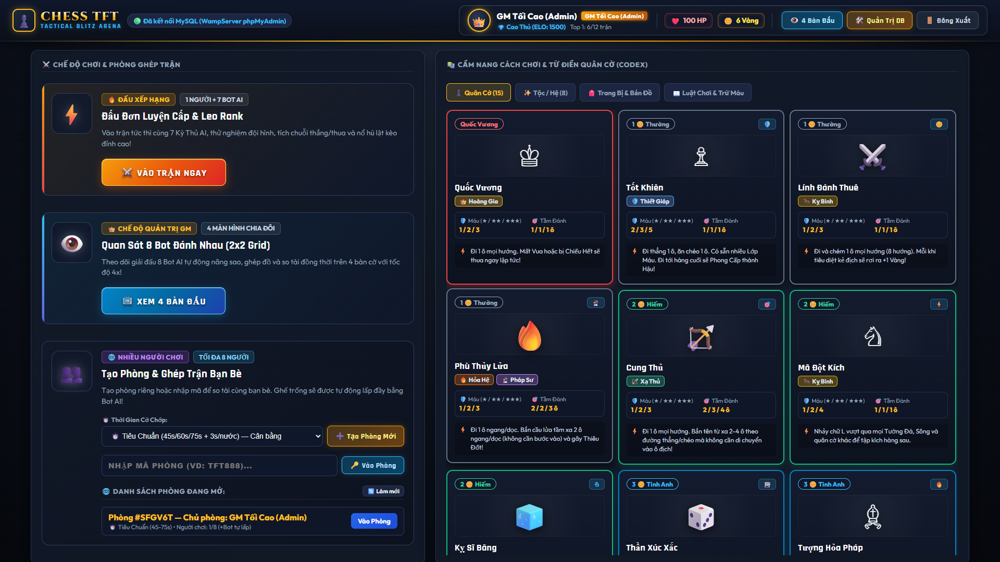
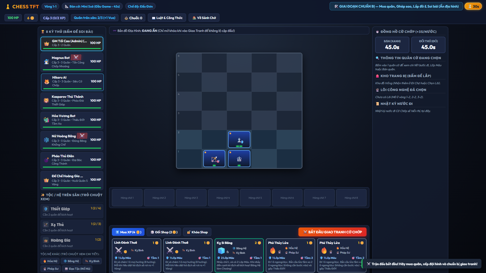

# ♟️ Chess TFT Online — Tactical Blitz Arena

> **Sự kết hợp đột phá giữa Cờ Vua Cổ Điển & Đấu Trường Chân Lý (TFT)**  
> *Chiến thuật đỉnh cao • Nâng sao & Kích hệ • Cờ chớp nghẹt thở • Nổ hũ lật kèo*

---

## 🌟 Giới Thiệu Dự Án

**Chess TFT Online** là tựa game web chiến thuật thời gian thực (Real-time Tactical Auto-Battler & Blitz Chess) độc đáo, dung hợp giữa:
- **Tư duy Cờ Vua chuẩn xác**: Quy tắc di chuyển, bắt quân, chiếu tướng, phong cấp và đồng hồ cờ chớp Blitz.
- **Cơ chế Đấu Trường Chân Lý (TFT)**: Mua sắm tướng trong cửa hàng, nâng cấp $1\bigstar \rightarrow 2\bigstar \rightarrow 3\bigstar$, kích hoạt Tộc/Hệ (Synergies), ghép Trang bị hoàn chỉnh, chọn Lõi Công Nghệ (Augments), và tích lũy chuỗi thắng/thua.

Giao diện được thiết kế theo phong cách **AAA Gaming Client** (tương tự Riot Client, Hearthstone) với chuẩn hiển thị Widescreen sắc nét, hiệu ứng hoạt họa sống động và âm thanh giao tranh chân thực.

---

## 📸 Hình Ảnh Giao Diện Thực Tế

| Sảnh Chờ Gaming Client & Từ Điển Codex | Bàn Đấu Cờ Chớp & Radar Soi Bài |
|:---:|:---:|
|  |  |

---

## ⚡ Các Tính Năng Nổi Bật

### 1. ⚔️ Lối Chơi Cờ Vua TFT Độc Đáo
- **Bàn cờ mở rộng theo Stage**:
  - **Stage 1 (Đầu game)**: Bàn cờ Mini `5x6` — Đồng hồ Blitz `45s + 3s/nước`.
  - **Stage 2 (Giữa game)**: Bàn cờ Mở rộng `6x7` — Đồng hồ Blitz `60s + 3s/nước`.
  - **Stage 3+ (Cuối game)**: Bàn cờ Chuẩn `8x8` — Đồng hồ Blitz `75s + 4s/nước`.
- **Cửa hàng & Nâng sao Tướng**: 5 vị trí ngẫu nhiên mỗi vòng. Mua 3 quân cờ cùng loại để tự động hợp nhất lên $2\bigstar$ và $3\bigstar$, gia tăng Lớp Máu (HP Layers) và Tầm đánh.
- **Hệ thống 15 Quân cờ & 8 Tộc / Hệ**:
  - **Tộc / Hệ**: Thiết Giáp (Giáp ảo), Xạ Thủ (Tầm bắn xa), Hoàng Gia (Thưởng vàng), Hỏa Hệ (Thiêu đốt), Băng Hệ (Đóng băng/Làm choáng), Pháp Sư (Cầu lửa), Kỵ Binh (Nhảy vượt chướng ngại vật), Đạo Tặc (Nổ hũ).
- **Hỗ trợ người mới tối đa**:
  - 🚨 **Cảnh báo Chiếu Tướng (King in Check Alert)**: Băng rôn cảnh báo rực rỡ và viền đỏ nhấp nháy tại ô Vua đang bị nguy hiểm.
  - 🟢 **Chấm xanh**: Hiển thị ô di chuyển hợp lệ.
  - 🟡 **Chấm vàng phát sáng**: Hiển thị các ô trong tầm bắn / kỹ năng khống chế.

### 2. 🔥 Cơ Chế Chuỗi Thắng / Chuỗi Thua & Lội Ngược Dòng (Comeback)
- **Thưởng vàng theo chuỗi**: Chuỗi 2-3 trận (+1🪙), chuỗi 4 trận (+2🪙), chuỗi 5+ trận (+3🪙).
- **🎲 Đổi Shop Miễn Phí (Free Rerolls)**: Khi dính chuỗi thua $\ge 3$ trận, mỗi vòng nhận ngay **+1 Lượt Đổi Shop Miễn Phí** giúp người chơi bài yếu dễ dàng lật kèo.
- **📦 Hòm Cứu Trợ Lội Ngược Dòng**: Chuỗi thua $\ge 4$ trận tặng ngay **+10 Vàng** và **1 Trang Bị Hoàn Chỉnh** ngẫu nhiên.
- **🛡️ Ý Chí Phục Thù (Last Stand)**: Khi Máu Linh Hồn lần đầu tụt xuống $\le 25$ HP, lập tức nhận:
  - **+15 Vàng**.
  - **Quốc Vương** nhận thêm **+1 Lớp Máu bảo hộ vĩnh viễn**.
  - Cộng thêm **+15 giây** vào Đồng Hồ Cờ Chớp Blitz.
- **🎰 Tộc Đạo Tặc (Nổ Hũ - Fortune)**: Tích lũy chuỗi trận thua để dồn điểm rương kho báu; khi thắng 1 trận sẽ Nổ Hũ nhận cơn mưa Vàng, Trang bị và Tướng 5 Vàng!

### 3. 🎮 Chế Độ Chơi Đa Dạng
- **Đấu Đơn Leo Rank (Solo AI)**: Tranh tài cùng 7 Kỳ thủ Bot AI thông minh (Magnus Bot, Hikaru AI, Kasparov, v.v.) tự động nâng sao và kích hệ.
- **Quan Sát 8 Bot Đánh Nhau (GM Spectator 4-Screen)**: Chế độ dành cho Admin/GM theo dõi giải đấu 8 Bot AI so tài đồng thời trên 4 bàn cờ cờ chớp (lưới 2x2) với tốc độ 2x / 4x và can thiệp tặng máu / nâng sao trực tiếp.
- **Tạo Phòng & Ghép Trận Bạn Bè (Multiplayer)**: Tạo phòng riêng, chia sẻ mã phòng 6 ký tự để so tài cùng bạn bè trong thời gian thực qua WebSockets (Socket.IO) hoặc máy chủ WampServer PHP/MySQL. Ghế trống tự động điền Bot AI.

---

## 🛠️ Kiến Trúc & Công Nghệ

Dự án được thiết kế theo kiến trúc **Dual-Backend** linh hoạt cao:
- **Frontend**: HTML5, Modern CSS3 (Dark Fantasy Gaming UI, Flexbox, CSS Grid), JavaScript ES6+ (Native OOP, Zero Frameworks nặng nề).
- **Backend Node.js**: Express.js + Socket.IO thời gian thực, lưu trữ file-based JSON Database (`db/`).
- **Backend PHP + MySQL**: Apache + PHP 7.4+ (`api.php`), cơ sở dữ liệu quan hệ MySQL (`database.sql`) tương thích hoàn hảo với WampServer / XAMPP / cPanel.
- **Kiểm thử tự động (QA)**: Playwright Core cho tự động hóa kiểm tra UI, viewport 1920x1080 và bắt lỗi runtime console.

---

## 🚀 Hướng Dẫn Cài Đặt & Chạy Game

### Cách 1: Chạy bằng Node.js (Khuyên dùng - Nhanh nhất)
1. Cài đặt [Node.js](https://nodejs.org/) (phiên bản 16 trở lên).
2. Mở terminal tại thư mục dự án và cài đặt dependencies:
   ```bash
   npm install
   ```
3. Khởi động máy chủ:
   ```bash
   npm start
   ```
   *(Hoặc click đúp vào file `start_game.bat` trên Windows)*.
4. Mở trình duyệt truy cập: **`http://localhost:3000`**.

---

### Cách 2: Chạy bằng WampServer / XAMPP (Apache + PHP + MySQL)
1. Khởi động WampServer hoặc XAMPP.
2. Sao chép toàn bộ thư mục dự án vào thư mục web:
   - WampServer: `C:\wamp64\www\chesstft\` (hoặc `F:\wamp\www\chesstft\`)
   - XAMPP: `C:\xampp\htdocs\chesstft\`
3. Mở **phpMyAdmin** (`http://localhost/phpmyadmin/`):
   - Tạo cơ sở dữ liệu mới tên: `chesstft_db`.
   - Bấm thẻ **Import** $\rightarrow$ chọn file [`database.sql`](database.sql) trong thư mục dự án để nạp cấu trúc và dữ liệu mẫu.
4. Mở trình duyệt truy cập: **`http://localhost/chesstft/`**.

---

## 🔑 Tài Khoản Trong Game

- **Đăng Ký Mới**: Người chơi tự do đăng ký tài khoản mới ngay trên màn hình game (chọn tên hiển thị, mật khẩu và avatar đại diện).
- **Tài Khoản Quản Trị (Admin / GM)**: Tài khoản quản trị dành riêng cho chủ sở hữu server để quản lý cấu hình và luật chơi.

---

## 📂 Cấu Trúc Thư Mục

```text
chessxtft/
├── db/                         # Dữ liệu JSON dự phòng cho Backend Node.js
│   ├── game_rules.json
│   ├── gameplay_entities.json
│   ├── matches.json
│   └── users.json
├── js/                         # Logic mã nguồn Frontend & Game Engine
│   ├── chess-engine.js         # Engine bàn cờ vua, tính toán nước đi & chiếu tướng
│   ├── data.js                 # Chỉ số tướng, 8 tộc/hệ, trang bị, bản đồ & lõi công nghệ
│   ├── tft-manager.js          # Hệ thống TFT (Shop, Roll, XP, Ghép sao, Comeback, Nổ hũ)
│   └── main.js                 # Quản lý UI, âm thanh SFX, đồng hồ Blitz, Render & WebSockets
├── qa_screenshots/             # Ảnh chụp nghiệm thu giao diện tự động từ Playwright
├── api.php                     # RESTful API Backend cho PHP + MySQL (WampServer/cPanel)
├── database.sql                # Cấu trúc bảng và dữ liệu mẫu MySQL
├── index.html                  # Giao diện chính (Auth, Sảnh Gaming Hub, Bàn cờ, Codex)
├── package.json                # Cấu hình dự án Node.js & dependencies
├── qa_test.js                  # Kịch bản kiểm thử giao diện tự động với Playwright
├── server.js                   # Máy chủ Backend Node.js Express + Socket.IO
├── start_game.bat              # Script khởi động nhanh 1-click trên Windows
├── styles.css                  # Toàn bộ CSS phong cách Gaming Client AAA
└── README.md                   # Tài liệu hướng dẫn dự án
```

---

## 👨‍💻 Tác Giả & Đóng Góp

- **Tác giả**: [DuyOrbit](https://github.com/DuyOrbit)
- **Repository**: [https://github.com/DuyOrbit/chessxtft](https://github.com/DuyOrbit/chessxtft)
- **Giấy phép**: MIT License.

---
*Chúc bạn có những ván cờ chớp nghẹt thở và những pha nổ hũ lật kèo ngoạn mục trong Chess TFT!* 🏆♟️
